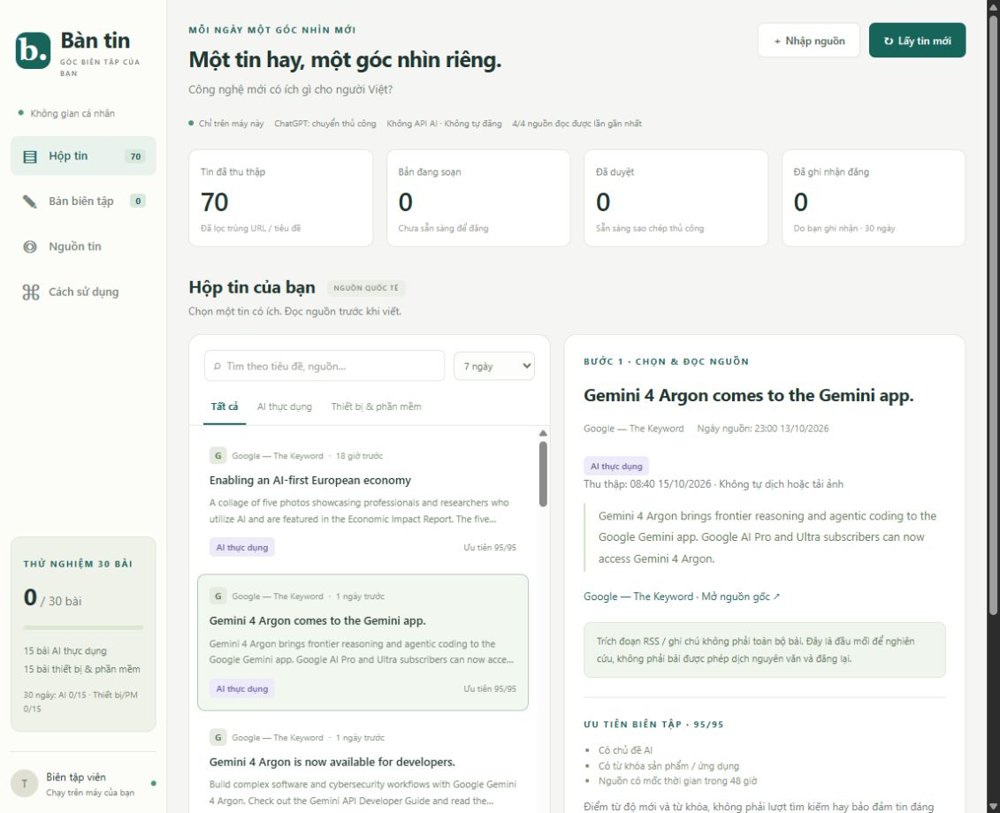

# Bàn tin — bản chạy trên máy tính của bạn

## Bản tin nhiều mục (đang phát triển)

Trên nhánh đang phát triển, Hộp tin cho chọn tối đa 10 tin để tạo bản tin. Mỗi mục giữ nguồn riêng; bạn có thể biên tập, kiểm chứng và tạo phiên bản Facebook, Threads hoặc X. Ứng dụng chỉ chuẩn bị văn bản và lưu nhật ký do bạn nhập; bạn tự đăng thủ công.

Chức năng này chưa hoàn tất nghiệm thu 0.4. Bộ đếm X dùng dữ liệu emoji của thư viện năm 2019; bộ đếm Threads là ước lượng thận trọng, chưa xác minh đầy đủ theo mọi emoji và ứng dụng. Kiểm tra lại văn bản trên nền tảng trước khi đăng. Xem [kế hoạch và các việc còn lại](docs/KE-HOACH-NANG-CAP-BAN-TIN-DA-KENH.md).

Trợ lý biên tập tiếng Việt cho hướng nội dung **“Công nghệ mới có ích gì cho người Việt?”**.

Ứng dụng lấy tin RSS/API và web được chọn, chuẩn bị tư liệu để bạn tự dùng ChatGPT Plus, lưu bài và hỗ trợ duyệt. **RSS/API/Crawl4AI không cần khóa model. Hermes + Browser Use là tầng tùy chọn, mặc định chưa kết nối, chỉ gọi AI sau khi bạn xác nhận riêng. Không đăng nhập ChatGPT hoặc tự đăng mạng xã hội.**



## Mở ứng dụng

1. Nhấp đúp **`MO-BAN-TIN.cmd`** trong thư mục này.
2. Giữ cửa sổ chạy mở. Trình duyệt sẽ mở tại [Bàn tin trên máy này](http://127.0.0.1:8877/).
3. Nếu trang đang được mở sẵn, chỉ cần quay lại trang và tải lại.

Máy hiện có Python 3.13.13, đã được dùng để kiểm thử. Phần RSS/API và biên tập yêu cầu Python 3.11 trở lên, không cần thư viện ngoài. Phần web dùng môi trường công cụ riêng; không cần Node.js, Docker hoặc WSL để vận hành.

Muốn tập thao tác với dữ liệu giả: nhấp đúp **`MO-BAN-MINH-HOA.cmd`**. Bản này có nhãn MINH HỌA, cổng 8878 và thư mục dữ liệu riêng; không tải RSS thật. Không đăng các bài ví dụ.

## Một bài đầu tiên

1. Trong **Hộp tin**, nhấn **Lấy tin mới**. Chọn một tin, mở và đọc nguồn gốc.
2. Nhấn **Tạo bản nháp** → **Sao chép sang ChatGPT** → **Mở ChatGPT**. Bạn tự đăng nhập Plus và dán tư liệu, không đưa mật khẩu cho ứng dụng này.
3. Trong **2. Biên tập**, nhập riêng tiêu đề, nội dung, góc nhìn và tên Facebook Page. Đừng dán cả bảng nhận xét của ChatGPT vào bài.
4. Bổ sung ghi chú kiểm chứng trong **Nguồn tham khảo & ghi chú kiểm chứng**. Nhấn **Lưu bản nháp**.
5. Sang **3. Duyệt & xuất**, hoàn tất 5 mục kiểm tra rồi **Duyệt phiên bản này**.
6. **Sao chép bài đã duyệt** hoặc tải tệp `.txt`, sau đó tự đăng lên Page. Ứng dụng không làm thao tác đăng.
7. Sau khi tự đăng, dán URL bài Facebook để ghi nhận. Có thể nhập lượt lưu, chia sẻ và thời gian chuẩn bị để theo dõi.

Hướng dẫn từng bước, sao lưu và xử lý lỗi: [HUONG-DAN-SU-DUNG.md](docs/HUONG-DAN-SU-DUNG.md).

## Mới trong bản 0.3: tự thêm nguồn theo dõi

1. Lưu bài đang sửa, dừng cửa sổ chạy cũ bằng Ctrl+C, mở lại `MO-BAN-TIN.cmd`, rồi tải lại trang. Chỉ tải lại trang chưa cập nhật phần xử lý. Dữ liệu schema2 được sao lưu thành `backups/pre-v03-*.sqlite3` trước nâng cấp; không sửa bài/bản nháp cũ.
2. Vào **Nguồn tin → Thêm nguồn theo dõi**. Nhập tên và URL HTTPS, ví dụ `DEV Community` / `https://dev.to/`.
3. Giữ **Tự tìm RSS/Atom**, đọc xác nhận và nhấn **Kiểm tra và thêm nguồn**. Chỉ kiểm tra URL bạn nhập và tối đa 3 địa chỉ feed cùng tên miền. Nguồn hợp lệ hiện ngay trong danh sách, đang bật; chưa thêm bài trong bước kiểm tra.
4. Nhấn **Lấy tin mới** để đưa bài vào **Hộp tin**. Nguồn cũng được đọc lúc khởi động và mỗi 2 giờ khi ứng dụng đang chạy. Tắt nguồn để dừng các lượt sau, không xóa tin/bản nháp đã có.
5. Nếu không tìm thấy RSS, dán địa chỉ RSS chính xác hoặc chọn **Đọc web bằng Crawl4AI**, nhập phạm vi như `/news/`. `/` cho phép toàn tên miền nên chỉ dùng khi thực sự cần. Không tự chuyển lỗi thành AI hay vượt robots/chặn truy cập.

Nút cũ đổi thành **Nhập bài thủ công**: chỉ thêm một bài và ghi chú vào Hộp tin, không tạo nguồn theo dõi và không tải website. Mục DEV Community đã nhập thủ công vẫn giữ nguyên; không tự chuyển đổi nó thành nguồn. Giới hạn 20 nguồn tùy chỉnh, chưa có sửa/xóa nguồn; dùng bật/tắt. API mẫu trong danh mục vẫn giữ adapter riêng, không tự đoán API của website mới.

## Nguồn có sẵn từ bản 0.2

1. Nếu Bàn tin cũ đang chạy, lưu bài rồi dừng cửa sổ chạy bằng Ctrl+C. Mở lại `MO-BAN-TIN.cmd` và tải lại trang. Chỉ tải lại trình duyệt không cập nhật phần xử lý đang chạy.
2. Vào **Nguồn tin**. Bốn RSS cũ vẫn bật; API GitHub Releases, TypeSafe Blog và Anthropic News mặc định tắt.
3. Bật từng nguồn muốn dùng rồi nhấn **Lấy tin mới**. Web dùng Crawl4AI cục bộ, tối đa 3 bài mới mỗi nguồn/lượt. Máy này đã cài công cụ trong môi trường của phiên kiểm tra; nếu mở ngoài Codex mà báo thiếu, chạy `CAI-CONG-CU-WEB.cmd` một lần.
4. Nếu cần điều hướng, ứng dụng ghi **tác vụ chờ**, không tự gọi model. Chưa kết nối Hermes vẫn dùng được RSS/API/web và nhập ghi chú thủ công.

[Hướng dẫn thu thập nhiều tầng, kết nối tùy chọn và xử lý lỗi](docs/THU-THAP-DA-TANG.md). Nâng cấp trực tiếp từ dữ liệu v0.1 tự tạo một tệp `pre-v02-*.sqlite3` trước khi thêm bảng mới; không tự sửa nội dung hay duyệt lại bài cũ.

## Những ranh giới quan trọng

- Dữ liệu hoạt động mặc định ở thư mục người dùng Windows, **ngoài OneDrive**. Xem đường dẫn thực tế tại **Cách sử dụng → Dữ liệu ở đâu?**; Windows có thể ánh xạ thư mục khi chạy từ ứng dụng đóng gói.
- Chỉ mở ở `127.0.0.1`, không chia sẻ qua Internet/LAN, không mở cổng hoặc dùng đường hầm công khai. Đây không phải máy chủ nhiều người dùng.
- Sửa bài, nguồn hoặc tên Page sẽ hủy duyệt. Nội dung đã ghi nhận đăng được giữ nguyên; tạo bản nháp khác nếu cần bài mới.
- Chỉ quản lý bài chữ, không tải hay cấp quyền ảnh. Dẫn nguồn không tự động cho phép sao chép / dịch toàn bộ bài.
- RSS có thể chỉ có mô tả ảnh hoặc tiêu đề; không coi là toàn văn. Bạn cần đọc, kiểm chứng và có góc nhìn riêng.
- Điểm ưu tiên / phân nhóm chỉ là gợi ý theo từ khóa và thời gian, **không phải Google Trends**, mức độ quan tâm thực tế hay chứng nhận độ tin cậy.
- Ứng dụng không xác minh điều kiện kiếm tiền, tính nguyên bản theo nền tảng hay doanh thu. Chưa có bài nào được hệ thống đăng ra ngoài.

## Nguồn ban đầu

- [Google — The Keyword RSS](https://blog.google/rss/)
- [Windows Blog RSS](https://blogs.windows.com/feed/)
- [Apple Newsroom RSS](https://www.apple.com/newsroom/rss-feed.rss)
- [Mozilla Blog RSS](https://blog.mozilla.org/en/feed/)
- Tùy chọn: [Crawl4AI Releases API](https://api.github.com/repos/unclecode/crawl4ai/releases?per_page=10), [TypeSafe AI Blog](https://typesafe.ai/blog), [Anthropic News](https://www.anthropic.com/news).

Đây là nguồn do hãng phát hành, không thay thế nguồn đối chiếu độc lập. Lần kiểm tra ngày 15/10/2026: đọc được 4/4 nguồn, thêm 70 tin trước khi lọc hiển thị theo thời gian. Đây là kết quả đọc RSS, không phải xác minh nội dung của 70 tin.

## Kiểm thử và cấu trúc

```powershell
python -m unittest discover -s tests -v
```

- [Kết quả và giới hạn kiểm thử](docs/KIEM-THU.md)
- [Thiết kế, dữ liệu và cách bảo trì](docs/KIEN-TRUC.md)
- [Phạm vi và nhật ký được duyệt](WORKLOG.md)

## Kế hoạch nâng cấp đang theo dõi

[Kế hoạch sửa lỗi và nâng cấp bản tin đa kênh](docs/KE-HOACH-NANG-CAP-BAN-TIN-DA-KENH.md) — lập ngày 03/11/2026, gồm hotfix liên kết bài đăng, bản tin nhiều mục, đầu ra Facebook / Threads / X, migration dữ liệu, tiêu chí nghiệm thu và checklist tiến độ. Đây là **kế hoạch, chưa phải các tính năng đã triển khai**; quy trình sử dụng hiện tại ở trên vẫn giữ nguyên.

Không cần mua API để dùng các tầng đọc tin thông thường và biên tập thủ công. Tầng trình duyệt AI cần kết nối model riêng nếu bạn chọn bật. Giới hạn số lượt/vòng không phải trần tiền; chưa đo được chi phí thực tế. Internet, điện và thuê bao đang có vẫn là chi phí của bạn.
